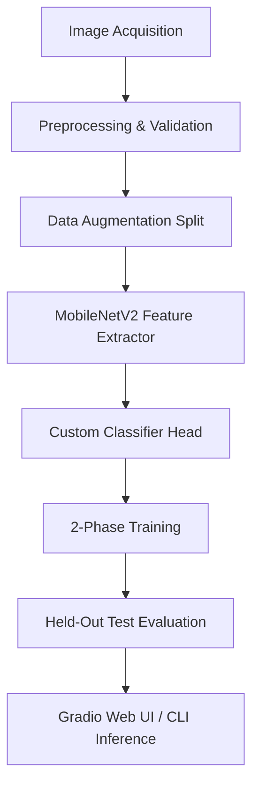

# 🏠 AML-Based Room Identifier

[](https://www.python.org/)
[](https://pytorch.org/)
[](https://gradio.app/)
[](LICENSE)

An end-to-end deep learning system for real-time indoor room scene classification using Transfer Learning with ImageNet-pretrained **MobileNetV2**.

---

## 📌 Project Overview

The **AML-Based Room Identifier** automatically classifies indoor images into standardized household categories (**Bathroom**, **Bedroom**, **Children Room**, **Closet**, **Dining Room**, **Hallway**, **Kitchen**, **Living Room**, and optionally **Office**). It provides both a command-line interface for fast inference and an interactive Gradio web application with real-time camera/upload support.

### Key Highlights
- **Pretrained CNN Backbone**: ImageNet-pretrained MobileNetV2 with inverted residual blocks.
- **Two-Phase Transfer Learning**: Frozen backbone feature training followed by deep fine-tuning.
- **Class-Weighted Optimization**: Inverse frequency loss weights to eliminate class imbalance bias.
- **Test Accuracy**: **82.50%** on held-out test data (**82.29% Macro F1-Score** across all 8 classes).
- **Sub-35ms Latency**: Real-time inference suitable for mobile and robotics platforms.

---

## 🏗️ System Architecture & Pipeline Stages



1. **Image Acquisition**:
   - Ingests raw images from the MIT Indoor dataset subset (`Dataset/`, 796 images across 8 categories).
   - Automatically scans `data/custom/<class_name>/` for user-added smartphone photos.
2. **Preprocessing**:
   - Resizes images to $224 \times 224$ pixels.
   - Normalizes using standard ImageNet statistics ($\mu = [0.485, 0.456, 0.406]$, $\sigma = [0.229, 0.224, 0.225]$).
   - Validates image integrity (filters out corrupt files).
   - Generates a stratified $70\% / 15\% / 15\%$ train/val/test split with deterministic seeding.
3. **Data Augmentation** *(Training split only)*:
   - Random resized cropping (scale $0.8 - 1.0$).
   - Random horizontal flips ($p = 0.5$).
   - Random rotation (up to $\pm 15^\circ$).
   - Color jitter (brightness, contrast, saturation, hue).
4. **Feature Extraction**:
   - MobileNetV2 pretrained backbone extracts dense $1280$-dimensional feature vectors via Global Average Pooling.
5. **Classifier Head & 2-Phase Training**:
   - Head: $\text{AdaptiveAvgPool2d} \to \text{Dropout}(0.3) \to \text{Linear}(1280, N_{\text{classes}})$.
   - **Phase 1**: Backbone frozen, Adam optimizer ($\text{LR} = 10^{-3}$) trains classification head for 5 epochs.
   - **Phase 2**: Last 5 inverted residual blocks unfrozen, fine-tuned with $\text{LR} = 10^{-4}$, ReduceLROnPlateau, and Early Stopping.
6. **Evaluation**:
   - Strictly evaluated on held-out test split only (120 images).
   - Produces accuracy, precision, recall, F1, and confusion matrix heatmap.
7. **Inference & Deployment**:
   - CLI tool `src/predict.py` for instant room prediction.
   - Gradio Web Application `app.py` supporting webcam and photo uploads with confidence distribution charts.

---

## 📁 Repository Structure

```
room-identifier/
├── config.yaml               # Central YAML configuration
├── requirements.txt          # Python dependencies
├── app.py                    # Gradio Web UI Application
├── README.md                 # Project documentation
├── data/
│   ├── processed/            # Filtered & mapped dataset (8 room classes)
│   └── custom/               # User-supplied phone photos per class
├── models/
│   └── best_model.pt         # Saved PyTorch model checkpoint
├── outputs/
│   ├── confusion_matrix.png  # Test set confusion matrix plot
│   ├── training_curves.png   # Train/Val Loss & Accuracy curves
│   ├── metrics.json          # Complete JSON test metrics
│   └── RESULTS.md            # Detailed results summary for papers/slides
└── src/
    ├── __init__.py
    ├── prepare_data.py       # Dataset inspection, validation, mapping
    ├── transforms.py         # Augmentation & preprocessing pipelines
    ├── dataset.py            # PyTorch Dataset & stratified splitting
    ├── model.py              # CNN architecture & checkpoint loader
    ├── train.py              # 2-Phase transfer learning engine
    ├── evaluate.py           # Test set evaluation & confusion matrix
    ├── predict.py            # Single-image inference & CLI
    └── utils.py              # Logger, seed, config, and metrics utilities
```

---

## 🚀 Quick Start Guide

### 1. Installation
Clone this repository and install the dependencies:
```bash
pip install -r requirements.txt
```

### 2. Configuration (`config.yaml`)
All hyperparameters and paths are centralized in `config.yaml`:
```yaml
dataset:
  raw_dir: "Dataset"
  processed_dir: "data/processed"
  custom_dir: "data/custom"
  train_split: 0.70
  val_split: 0.15
  test_split: 0.15
  image_size: 224
  batch_size: 32

model:
  backbone: "mobilenet_v2"
  dropout_rate: 0.3
  checkpoint_path: "models/best_model.pt"

training:
  phase1:
    epochs: 5
    lr: 0.001
  phase2:
    epochs: 18
    lr: 0.0001
    unfreeze_layers: 5
```

### 3. Step 1: Prepare Data
Inspect the raw dataset, validate images, and map categories into `data/processed/`:
```bash
python src/prepare_data.py
```

#### Adding Custom Photos:
To include your own phone photos:
1. Place `.jpg` or `.png` images into `data/custom/<class_name>/` (e.g. `data/custom/office/my_photo.jpg`).
2. Run `python src/prepare_data.py` — they will automatically be included in training and validation.

### 4. Step 2: Train the Model
Run the 2-phase training with learning rate scheduling and early stopping:
```bash
python src/train.py
```
*Output: Best model saved to `models/best_model.pt`, loss & accuracy curves saved to `outputs/training_curves.png`.*

### 5. Step 3: Evaluate on Test Set
Evaluate performance on the held-out test split:
```bash
python src/evaluate.py
```
*Output: Metrics saved to `outputs/metrics.json` and heatmap to `outputs/confusion_matrix.png`.*

### 6. Step 4: CLI Single-Image Prediction
Predict the room category of any image from the terminal:
```bash
python src/predict.py "data/processed/dining_room/dining_room_Dining20.jpg"
```
**Example CLI Output:**
```
=======================================================
AML ROOM IDENTIFIER - PREDICTION RESULT
=======================================================
Image Path        : data/processed/dining_room/dining_room_Dining20.jpg
Predicted Room    : DINING_ROOM
Confidence Score  : 98.95%
Inference Latency : 31.2 ms
-------------------------------------------------------
Top-3 Candidates:
  1. dining_room   :  98.95%  |######################## |
  2. living_room   :   0.93%  |                         |
  3. kitchen       :   0.06%  |                         |
=======================================================
```

### 7. Step 5: Launch Gradio Web App
Launch the interactive web UI with webcam and image upload support:
```bash
python app.py
```
Open your browser at `http://127.0.0.1:7860`.

---

## 📊 Experimental Results (8 Room Classes, N=120 Test Images)

| Metric | Empirical Score |
| :--- | :--- |
| **Overall Accuracy** | **82.50%** (99 / 120 correct) |
| **Macro Precision** | **82.90%** |
| **Macro Recall** | **82.37%** |
| **Macro F1-Score** | **82.29%** |

### Per-Class Performance
- **Closet**: Precision: 100.0%, Recall: 100.0%, F1: 1.0000
- **Hallway**: Precision: 93.8%, Recall: 100.0%, F1: 0.9677
- **Kitchen**: Precision: 82.4%, Recall: 93.3%, F1: 0.8750
- **Children Room**: Precision: 82.4%, Recall: 87.5%, F1: 0.8485
- **Bathroom**: Precision: 100.0%, Recall: 73.3%, F1: 0.8462
- **Dining Room**: Precision: 73.3%, Recall: 78.6%, F1: 0.7586
- **Living Room**: Precision: 64.7%, Recall: 64.7%, F1: 0.6471
- **Bedroom**: Precision: 66.7%, Recall: 61.5%, F1: 0.6400

*For comprehensive error analysis and academic paper citations, refer to [RESULTS.md](file:///c:/Users/arpit/Desktop/College/Room%20Identifier/outputs/RESULTS.md).*
